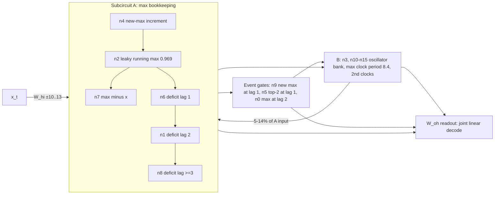

# How ARC's 432-parameter 2nd-argmax RNN works — swarm algzoo-432, 2026-10-17

Model: `example_2nd_argmax()` from https://github.com/alignment-research-center/alg-zoo (M_{16,10}:
1-layer ReLU RNN, no biases, 16 hidden, 10 inputs; W_hi 16 + W_hh 256 + W_oh 160 = 432). Task: index of
the 2nd-largest of 10 inputs. Accuracy 95.3% on N(0,1) (ours: 0.9529, n = 1e6). Source post:
https://www.alignment.org/blog/algzoo-uninterpreted-models-with-fewer-than-1-500-parameters/

## 1. Result

**Headline (plain facts).**
- Strict goal (compact hand-written algorithm AND ≥ 0.98671 agreement) is **not met**.
- Readable algorithm C1 (2nd argmax with a phantom zero): **0.955** on the holdout.
- Network-shaped description at the floor: **374 numbers at 4 digits, 0.98933** on the holdout (an upper
  bound on the needed size, not a proven minimum; still the 16-neuron recurrence).
- Mechanism explained with tests: phantom zero, subcircuit A registers (leaky max, increment, deficit
  shift register), event gates n9/n0 (and n5, fitted), max clock in the B oscillator bank.
- Esben: no answer to #1572 (asked 10:33) by 11:05 room time; options 1 and 2 there give the same
  artifacts, so this section states facts only (Felix #1599).

| bar / candidate | agreement with model, holdout seed 432432, N = 1e6 |
|---|---|
| original bar (Esben, 10:14) | ≥ 0.99 |
| revised bar (Esben 10:29 "Reducer til under støjgulvet"; noise level 0.1% chosen 10:22, bar frozen 10:30 by Rasmus; note: Felix scored C1 on the holdout at 10:28, before the freeze — C1 has 0 tuned constants, so no leak) = mean agreement of the model with itself under 0.1% weight noise, 20 draws | **≥ 0.98671** (sd 0.0042, min 0.9755, max 0.9924; at 0.03% noise: 0.9961) |
| null: true 2nd argmax | 0.95283 |
| C1 `algorithm_compact.py` (Felix): streaming 2nd argmax with a phantom 0 at position −1, 4 literals, 0 fitted constants | **0.95503** [0.95462, 0.95543] — FAIL |
| D2-style pruned + rounded network (Felix ladder.md; full gauge = 400 free numbers; holdout by Rasmus #1579): smallest we found = 374 numbers at 4 significant digits (an upper bound from greedy pruning + uniform rounding, not a proven minimum) | **0.98933** pass — but about 2× the 200-literal cap and still the 16-neuron recurrence |
| same: 374 numbers at 3 digits / 382 at 3 digits / 386 at 3 digits | 0.98407 FAIL / 0.98673 (tie with floor) / 0.98771 |

- C1 reproduces the model where the model is right (0.998) and the phantom-zero errors, but only 8.6% of
  the model's other errors. Passing the revised bar needs ≥ 72% of them.
- Strong evidence (not proof) that no *compact* algorithm reaches either bar: the model's near-tie
  decisions depend on the 3rd–4th significant digit of its weights. Rounding all weights to 3 significant
  digits gives 0.982–0.986, 4 digits 0.998, 2 digits 0.68 (Bruno, Rasmus, Kasper, independent runs).
  347 of 432 single entries change > 1% of outputs when set to zero (blocks.md). Oracle ceilings for
  compact families: decision tree 256 leaves 0.9555, 720-cell Jacobian lookup 0.909, exact local Jacobian
  on top-5 inputs 0.975 (algorithm_compact.md). Best possible rule on (positions of top-3, binned gaps,
  signs), even with 398k cells: 0.965 on held-out samples (research.md s.6, cell_ceiling.py). Exact 2nd argmax of a linearly
  distorted input y = G·x (per-position gains, or full 10×10 crosstalk, 100 fitted constants): 0.954 /
  0.952 (Bruno, scratch/distorted_2nd_argmax.py). Gradient-boosted trees on rank/gap/value features:
  0.934–0.960 (Bruno; Kasper peak 0.960 with 2e6 training samples). Trees are weak at linear
  combinations, so this caps rank/gap/position-level rules, not every rule.
- Distilling the model into small networks gave no description-length bound (Bruno, distill_curve.md):
  MLPs with 178–5,386 parameters reached 0.354–0.856 and RNNs with hidden size 6–12 reached 0.358–0.469,
  while a same-size (d = 16) student reached only 0.702 after 6.1e7 training sequences. All are below the
  zero-parameter true 2nd argmax (0.953), so the recipe is optimization-limited. No small network
  reaching the floor was found; this is not evidence that none exists.
- What we deliver: a mechanism map with a falsifiable test per claim (section 3), the compact algorithm
  above with its measured gap, and a table that covers all 432 entries (section 4, blocks.md,
  blocks_links.md).
- This is NOT ARC's open challenge (a mechanistic *estimate of accuracy* that matches random sampling in
  mean-squared-error vs compute). We do not claim to solve it.

## 2. The mechanism in one page



1. **Input.** Only five neurons read x strongly: n4 (+10.2) and n1, n6, n7, n8 (−10.6 to −13.2). n14 has
   −1.32; the other ten have |W_hi| < 0.3 (research.md s.4).
2. **Subcircuit A = max bookkeeping** (subA.md s.2, deficit basis d_k = n_k − n7):
   n2 is a leaky running max (n2 ← 0.969·n2 + n4); n4 = ReLU(x − 0.852·n2 − 0.986·n4) is the new-max
   increment; n7 = ReLU(0.899·n2 + 1.016·n4 − x) is "max minus last input" and is read only through the
   deficits; n6, n1, n8 form a shift register "the max was 1 / 2 / ≥ 3 inputs ago" whose value is the gap
   to the next value. This refines ARC's leave-one-out-max reading; the exact non-integer gains matter
   (integer gains: 0.22 agreement).
3. **Event gates** (denseB2.md). Pure rank predicates on x explain when these neurons are on:
   n9 on iff the last input was a new running max (gate swap 0.9953); n0 off iff the max arrived exactly
   2 steps ago (0.9968); n5 on iff the last input beat ~0.8 × the earlier 2nd max (fitted comparator,
   0.9917). The vetoes come from single weights: W_hh[9,7] = −5.03 on n7; n5 vetoed by n7 and n8; n0 by
   the previous n5 and n9 (a lag-2 delay line). n5's final value is a direct vote for position 8
   (W_oh[8,5], the only large entry in its column).
4. **B = oscillator bank** (denseB1.md). n3, n10–n15 are not interpretable one by one (no rank gate beats
   "always on"). In the dominant quiet ReLU pattern the effective matrix has a "max clock" mode
   (|λ| = 0.951, 0.746 rad/step, period 8.4 steps) whose phase equals steps-since-max × 0.746
   (coherence 0.96–0.98), and "2nd clock" modes (periods 4.3, 2, 2.9) that track steps since the 2nd max
   when it came after the max (0.66–0.68). Likely the same object as Keane's "phase wheel" (research.md
   s.3; not tested directly).
   A new max writes a fixed phase into the max clock (circular concentration 0.95–1.00 for positions
   ≤ 5; weaker when the new max barely beats the old one), then the phase advances 0.734 rad/step
   (explained_model.md addendum, modes_c2.py).
   B is driven by A (zero W_hh[B,A] → 0.104) and feeds back 5–14% of A's input (zero W_hh[A,B] → 0.513).
5. **Readout.** Position of the max is linearly readable from A alone for recent positions (probe 0.99 at
   pos 9) and from B for older ones; the 2nd-max position is only readable from the joint state, at exactly
   the model's accuracy (probe 0.952; explained_model.md). The readout is not low-rank (rank 8 of 9:
   0.92 agreement). A rotating phase template per clock mode fitted to W_oh decodes positions 0–3 well
   (0.977) but not all positions (0.921) (modes_c2.py).

## 3. Evidence tiers (agreement with the model when a claim replaces the real computation)

| tier | claim | test | agreement | source |
|---|---|---|---|---|
| 1 formula holds | n2 is linear (never clips) | drop ReLU | 0.9993 | explained_model.md |
| 1 | n2 ignores input | W_hi[2] = 0 | 0.9976 | explained_model.md |
| 1 | n9 = "last input is a new max" | gate swap | 0.9953 | denseB2.md |
| 1 | n0 = "max not exactly 2 steps ago" | gate swap | 0.9968 | denseB2.md |
| 1 | n13, n12 linear | drop ReLU | 0.9988, 0.9957 | denseB1.md |
| 1* | n5 = comparator vs ~2nd max (fitted constants) | gate swap | 0.9917 | denseB2.md |
| 2 qualitative | n4 = ideal increment | formula swap | 0.963 | subA.md |
| 2 | n7, n6, n1 = ideal LOO-max forms | formula swap | 0.526, 0.475, 0.391 | subA.md |
| 2 | n10, n11, n14, n3 near-linear | drop ReLU | 0.981, 0.988, 0.988, 0.979 | denseB1.md |
| 2 | n15 near-linear | drop ReLU | 0.908 | denseB1.md |
| 3 mode level | max clock phase = steps since max | demodulated coherence | 0.96–0.98 | denseB1.md |
| 3 | 2nd clock phase = steps since 2nd (2nd after max) | coherence | 0.66–0.68 | denseB1.md |
| falsified | A is a closed subcircuit (ARC) | zero W_hh[A,B] | 0.513 | subA.md |
| falsified | B is a linear filter of A | drop all B ReLUs | 0.141 | explained_model.md |
| falsified | the B←B sub-block alone is a few modes (not Felix's claim, which is about the pattern-specific full matrix D·W_hh) | keep top-k eigenmodes of B←B | ≤ 0.17 | explained_model.md |
| falsified | top-2 inputs decide (Keane) | keep top-2, rest 0 | 0.947 | research.md |

## 4. Every parameter block (PREREG item 6)

Every block has a measured sensitivity: zero / +1% disagreement for all 432 entries in `ablate.json`,
per-row link tables in `blocks_links.md`. Named formula roles exist for subcircuit A (subA.md deficit
basis), the gates n0/n5/n9 (denseB2.md), and single links such as W_hh[9,7] (veto), W_hh[2,2] (leak
0.969), W_hh[1,6] (shift) and W_oh[8,5] (vote). All other per-entry roles are auto labels
("source → target, excite/inhibit"), not formulas (PREREG 4c; Kasper #1540, Rasmus #1573).
Groups: A = {1,2,4,6,7,8}, gate = {0,5,9}, B = {3,10,…,15}.

| block | entries | role | evidence |
|---|---|---|---|
| W_hi[1,4,6,7,8] | 5 | the only strong input path: +x into n4, −x into the deficit/max-minus-x neurons | zero → 78–88% disagreement each |
| W_hi[14] | 1 | moderate −x into a B carrier | zero → 10.9% |
| W_hi others | 10 | small direct inputs (|w| < 0.3); W_hi[5] = −0.28 sets n5's −0.28·x_t term | zero → 0.2–2.5% each |
| W_hh[A,A] | 36 | max bookkeeping: leak 0.969, increment, max-minus-x, deficit shift register (subA.md s.2 matrix) | median zero 48.7%; +1% up to 4.6% (W_hh[7,2], W_hh[2,2]) |
| W_hh[A,B∪gate] | 60 | small feedback from B and gates into A (5–14% of A input) | block zero → 0.513 |
| W_hh[gate,A] | 18 | vetoes and drives of the event gates (W_hh[9,7] veto, W_hh[5,7], W_hh[5,8] vetoes, W_hh[9,4] drive) | median zero 15.4% |
| W_hh[gate,gate∪B] | 30 | lag-2 delay (W_hh[0,5], W_hh[0,9]) and B input to gates | median zero 3.7–4.8% |
| W_hh[B,A∪gate] | 63 | A and gates write events into the oscillator bank | zero W_hh[B,A] → 0.104 |
| W_hh[B,B] | 49 | oscillator bank dynamics (role at mode level only) | median zero 16.1% |
| W_oh[:,A] | 60 | recent-position and gap readout | median zero 8.7% |
| W_oh[:,B] | 70 | older-position (clock phase) readout | median zero 6.5% |
| W_oh[:,gate] | 30 | n5 → logit 8 vote; n0 → logits 1, 2, 7 suppression; n9 column negligible (≤ 0.3%) | median zero 0.6% |

Only 20 of 432 entries are negligible (zero → < 0.1%; listed in blocks.md). For B-internal links the
role exists only at mode level (denseB1.md), not per entry.

## 5. Where and why the model is wrong (4.7% of N(0,1) inputs)

- 63% of errors pick the 3rd-largest, 21% the largest, 16% rank ≥ 4 (research.md s.2; Kasper, Felix).
- 58% of errors have gap(2nd − 3rd) < 0.05. The local decision between 2nd and 3rd is c·(S − k·T), and k
  varies by configuration (median 0.92, IQR 0.55; Felix, PLAN.md update). But no per-position gain or
  linear crosstalk model reproduces the errors (exact 2nd argmax of G·x: 0.952–0.954; Bruno), and
  scale margins only lower agreement (algorithm_compact.md).
- ~18% of errors are inputs with at most one positive value (2nd max ≤ 0; error rate 78% there): the
  max(0, …) features treat 0 as an extra element ("phantom zero").
- Candidate mechanism for 2nd-vs-3rd confusion: n5's comparator mixes the 3rd max into its threshold
  (T' coefficient up to −3.8 at t = 9; denseB2.md).

## 6. Prior work and what is new

Prior: ARC post (N2/N4/N6/N7/N1 LOO features); Zihao Chen notes (2024; N8, max sub-circuit; model was
trained on Unif[−1,1]); Goldowsky-Dill (N1/6/7/8 ≈ a(δ)·M + b(δ)·S⁺); Keane (phase wheel, (gap,
direction) ReLU patterns, top-2 predictor). Hilton (2026-08-17): no other public effort. Links in
research.md s.3.

New here: (a) deficit-basis structure of A and its exact gains; A is not closed (0.513); (b) n9/n0 as exact
rank-event gates and n5 as a 2nd-max comparator, with swap tests; (c) mode-level clock coherence numbers
for B; (d) a full 432-entry sensitivity/role map; (e) quantitative evidence that the 99% agreement bar is
below the model's own weight-noise floor; (f) Keane's "top-2 decides" claim fails on N(0,1) (0.947).

## 7. Limits

- None of our compact algorithms reaches 0.99 or the revised 0.98671 floor (best: C1, 0.955). This is
  evidence, not proof, that none exists. The revised bar is met only by the pruned, rounded 16-neuron
  network (374–386 numbers), which is not a compact explanation.
- n5's comparator constants and Felix's k are fitted on dev seeds, not derived from weights.
- B is explained at mode level in one ReLU pattern (16% of late states); the event-time write rule (how a
  new max sets clock phases) is not derived.
- Swap tests are per family; errors compound (n0+n5+n9 together: 0.9855).

## 8. Reproduce

```
cd swarm-algzoo-432
.venv/bin/python research_baselines.py   # baselines, research.md s.2 (Iris)
.venv/bin/python cell_ceiling.py         # top-3 cell-majority ceiling, research.md s.6 (Iris)
.venv/bin/python subA.py; .venv/bin/python swapA.py    # subcircuit A (Bruno)
.venv/bin/python denseB1.py              # B oscillator bank (Felix)
.venv/bin/python denseB2.py              # gates n0/n5/n9 (Iris)
.venv/bin/python explained_model.py      # role tests (Bruno)
.venv/bin/python modes_c2.py             # clock phase write + phase-template readout (Bruno)
.venv/bin/python ablate.py && .venv/bin/python blocks_links.py   # 432-entry table (Iris)
.venv/bin/python ladder.py               # pruned/rounded network ladder (Felix)
.venv/bin/python scratch/distorted_2nd_argmax.py               # 2nd argmax of G·x (Bruno)
.venv/bin/python distill_curve.py        # small-network distillation curve, 5.5 min (Bruno)
.venv/bin/python check_agreement.py algorithm_compact.py --seed 5 --n 300000   # C1 on a dev seed
.venv/bin/python check_agreement.py algorithm_compact.py       # C1 on the holdout (Rasmus checker)
```
